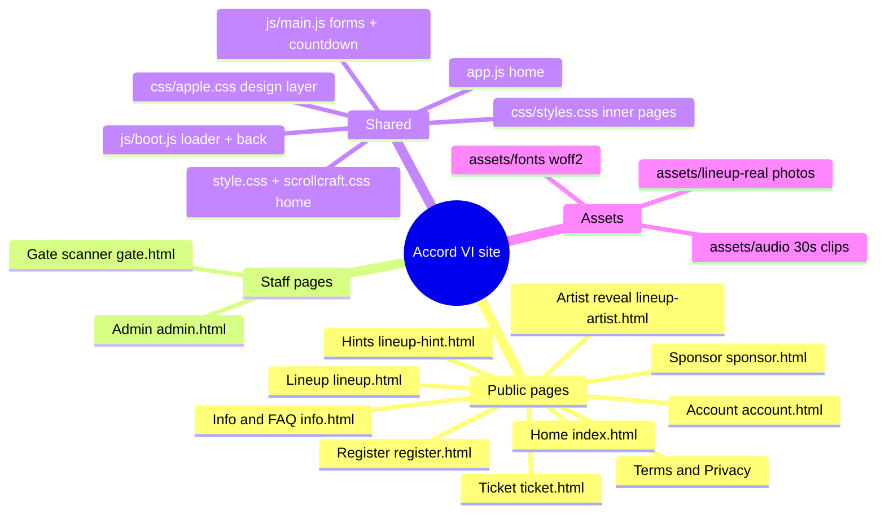

# CODEMAP: Accord VI website
Updated: 2026-10-23 · Version: v2 (turquoise theme applied; live site was commit a00759b before these rounds)

## What this is
The website for Accord VI, a two-night student music event at Beaconhouse Cantt Campus, Multan,
on Saturday 21 and Sunday 22 November 2026. Plain HTML, CSS and JavaScript, no framework. GitHub Pages
publishes only `builds/accord-vi-immersive/` (see `.github/workflows/deploy.yml`). Accounts, payments,
tickets and emails run on a separate Cloudflare Worker (repo `accord-vi-verify-worker`, map in its `ACCOUNTS.md`).

## Mind map

## Where things live
| Feature (plain English) | File | Search for |
|---|---|---|
| Logo loading screen when the site first opens | js/boot.js | `@section intro-loader` |
| Back arrow at the top-left of inner pages | js/boot.js, css/apple.css, each page header | `@section back-button` |
| Button sizes (52px main, 44px small) | css/apple.css | `@section button-scale` |
| "Tap" on phones vs "Click"/"Hover" with a mouse | css/apple.css + `for-touch`/`for-mouse` spans | `@section device-words` |
| Countdown on the home page | app.js | `@section countdown` |
| Countdown on inner pages | js/main.js | `@section countdown` |
| Event date text (hero, footers, schedule, passes) | every page; search `21–22 November` / `21 November` | (text) |
| Event dates for Google (structured data) | index.html, info.html, register.html | `"startDate"` |
| Artist names, bios, photos, song clips, colours | lineup-artist.html | `@section artist-data` |
| Song clips (30 s each) | assets/audio/*.mp3 | (files) |
| Fonts | style.css, css/styles.css, artists.css, lineup*.html | `@section fonts` |
| Form text boxes (16px so iPhones don't zoom) | css/styles.css | `@section form-fields` |
| Press feedback, popups closing, hit areas | css/apple.css | numbered sections 1–6 |
| Sponsor logo strip and its Pause button | js/marquee.js, sponsor.html | `marqueeToggle` |
| Event dates in emails and ticket labels | worker repo src/accounts.js | `21 November` |
| Site colours: deep teal leads, gold is the partner | css/styles.css (inner pages), style.css (home), artists.css, lineup.html + lineup-hint.html | `--color-primary` / `--color-gold`, `--sc-accent` / `--sc-gold`, `--lead` / `--partner` |
| Email colours (button, header) | worker repo src/accounts.js | `#0f8f87` |

## Settings the owner or Yilmaz fills in
- Theme (client pick 23 Oct 2026): Turquoise & Gold, deep teal #0F8F87 leads, gold #E0B455 is the partner
  (logo "VI", badges, tags, card letters). Gold also stays where it means something: the Gold sponsor tier,
  "pending" status, avatar choices. Buttons fade from #3AA39D into #0F8F87 so dark button text stays readable.
- Event dates: text on every page (above) plus the countdown targets in app.js and js/main.js
  (`2026-11-21T00:00:00+05:00`, Pakistan time) and the worker's email text in src/accounts.js.
- Loading screen timing: js/boot.js `MIN_MS` (900, animation length) and `MAX_MS` (1800, hard cap).
- Sponsor contact email: still the placeholder `hello@accordvi.example` (sponsor, terms, privacy).
- Real JazzCash / bank details: still placeholders on register.html.

## How to run and check it
- Local preview: `.claude/launch.json` in the old "Accord website" folder, entry `accord-live-site` (port 4501).
- Phone checks: `lab/phone-tools/` (git-ignored) drives headless Chrome with real phone emulation.
  `node verify.mjs http://localhost:4501/ out` (every page, phone + desktop), `node phone-audit.mjs <base> <out> <pages…>`
  (screens + UX numbers), `node intro-frames.mjs <url> <out>` (films the loading screen), `node syntax-check.mjs`.
  The in-app browser pane is too small for phone screenshots, so use these instead.
- Turquoise theme picker (pending the client's choice): https://claude.ai/artifact/Rk2ZcZUtYV1jvyWVazE94Y
- Worker tests: in the worker repo, `node test-*.mjs` against a local worker (266 checks).

## Graphify
Graph of worker + site at `C:\Users\HP\accord-graphs\project\graphify-out` (last built 2026-10-05,
before this round). Rebuild: `PYTHONUTF8=1 ...graphifyy\Scripts\python.exe C:\Users\HP\accord-graphs\build_graphs.py`.

## Gotchas
- css/apple.css is linked LAST on every page; new pages must link it, and new site-wide rules go there.
- Four pages (info, register, sponsor, privacy) use Windows line endings; scripted edits must match `\r\n`.
- The home page's "See the lineup" button has an inline `display` style; it must stay `inline-flex`.
- Inside a flex button, a normal space next to a hidden span disappears; use `&nbsp;`.
- Worker changes do nothing until deployed (`wrangler deploy`); the site goes live on push to `main`.
- `lab/` is not published and holds old test output.
